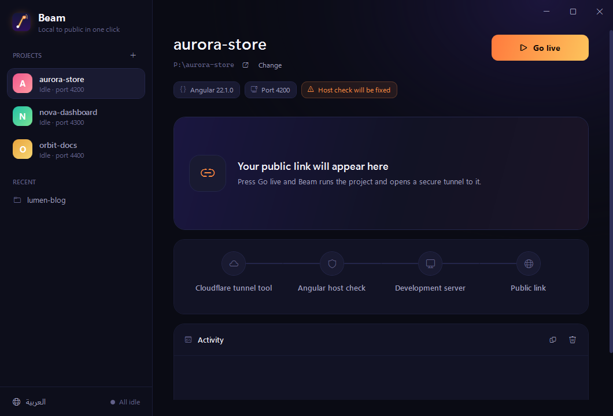
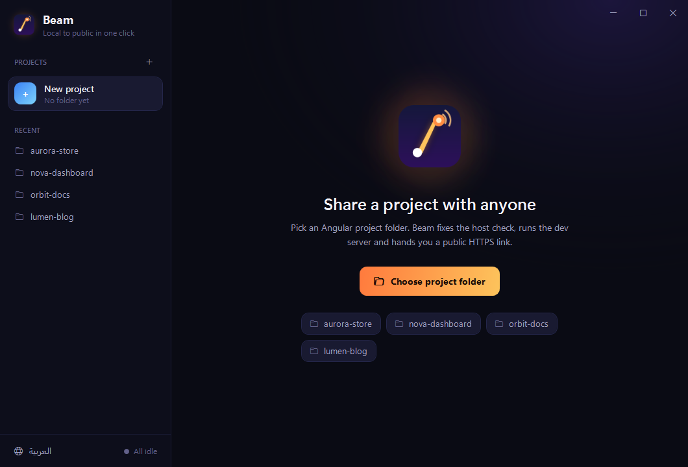
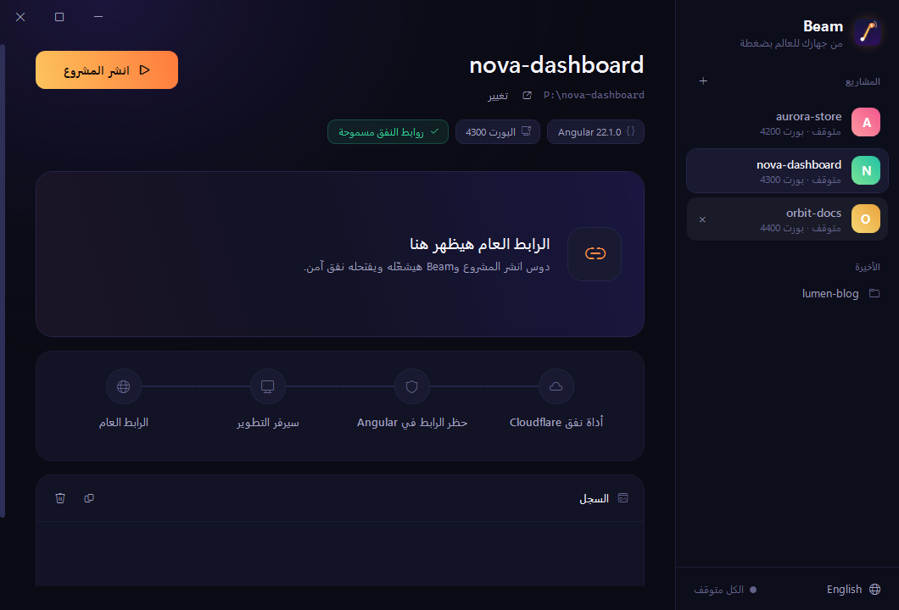

<div align="center">


# Beam

**Share a local Angular project with anyone, through a public HTTPS link, in one click.**

[](https://github.com/aly-abdullah/beam/releases/latest)
[](LICENSE)


[Download](https://github.com/aly-abdullah/beam/releases/latest) · [How it works](#how-it-works) · [Build from source](#build-from-source) · [بالعربي](#بالعربي)



</div>

## Why Beam

You finished a feature and want a client, a teammate or your phone to see it. Deploying is overkill, and exposing `localhost` by hand means installing a tunnel tool, running it in a second terminal, and then fighting Angular's dev server when it answers with:

```
Blocked request. This host ("random-words.trycloudflare.com") is not allowed.
```

Beam does all of it for you. Pick the project folder, press **Go live**, and copy the link.

## Features

- **One click to a public link.** A free [Cloudflare quick tunnel](https://developers.cloudflare.com/cloudflare-one/connections/connect-networks/do-more-with-tunnels/trycloudflare/) gives you an `https://*.trycloudflare.com` URL. No account, no domain, no router setup.
- **Fixes the Angular host check.** Beam adds `.trycloudflare.com` to `allowedHosts` in `angular.json`, and keeps your untouched file next to it as `angular_original.json`.
- **Several projects at once.** Every project gets its own dev server, port, link, QR code and activity log. Ports are picked so two projects never collide, even with servers Beam did not start.
- **Remembers your workspace.** Open projects and the selected one come back the next time you launch Beam.
- **Installs what it needs.** If `cloudflared` is missing, Beam downloads the official build. If `node_modules` is missing, it runs `npm install` first.
- **QR code** for opening the link on a phone in a second.
- **Lives in the tray.** Close the window while sharing and Beam keeps the links up. The tray menu copies, opens or stops each live project.
- **Arabic and English**, with a full right-to-left layout.

## How it works

| Step | What Beam does |
|---|---|
| 1. Cloudflare tunnel tool | Finds `cloudflared.exe` (Beam's own copy, Program Files, or `PATH`) or downloads the latest release from [cloudflare/cloudflared](https://github.com/cloudflare/cloudflared/releases). |
| 2. Angular host check | Adds `".trycloudflare.com"` to the serve target's `allowedHosts`. The first time, the original file is renamed to `angular_original.json`. |
| 3. Development server | Runs `ng serve --port N` with the project's port, or the next free one, and waits until it answers. |
| 4. Public link | Runs `cloudflared tunnel --url http://localhost:N` and shows the link it returns. |

Pressing **Stop** ends both processes.

<div align="center">


</div>

## Requirements

- Windows 10 or 11 (x64)
- [Node.js](https://nodejs.org) and an Angular CLI project (a folder with `angular.json`)

The installer is self-contained, so you do not need to install .NET.

## Install

1. Download `Beam-Setup-1.1.0.exe` from the [latest release](https://github.com/aly-abdullah/beam/releases/latest).
2. Run it. Beam installs for your user only, so there is no admin prompt, and the setup is available in English and Arabic.

Windows SmartScreen may warn about an unsigned app the first time. Choose **More info**, then **Run anyway**.

## Good to know

- **The link is public.** Anyone who has it can open your app while Beam is sharing it. Do not share projects that expose secrets or real data.
- **It is a development server.** `ng serve` is not built for production traffic. Beam is for previews and reviews, not hosting.
- **The link changes every run.** Quick tunnels get a random name each time and come with no uptime guarantee. For a fixed name, use a [named Cloudflare tunnel](https://developers.cloudflare.com/cloudflare-one/connections/connect-networks/) with your own domain.
- **Where Beam keeps things:** settings in `%AppData%\Beam\settings.json`, the downloaded `cloudflared.exe` in `%LocalAppData%\Beam`.
- **Undoing the angular.json change:** delete `angular.json` and rename `angular_original.json` back.

## Build from source

```bash
git clone https://github.com/aly-abdullah/beam.git
cd beam
dotnet build -c Debug
```

Publish a single-file build into `App/`:

```bash
dotnet publish -c Release -o App
```

Quit Beam from the tray before publishing again, or the running `Beam.exe` locks the output.

### Project layout

```
Core/
  AngularProject.cs   reads angular.json, patches allowedHosts, finds free ports
  Cloudflared.cs      finds or downloads cloudflared
  TunnelSession.cs    runs the four steps for one project and streams its log
  Loc.cs              Arabic and English strings
  Settings.cs         language, recent folders and open projects
MainWindow.xaml(.cs)  window, sidebar, link card, stepper, activity log, tray
App.xaml              design tokens and control styles
```

## Contributing

Issues and pull requests are welcome. For larger changes, open an issue first so we can agree on the direction.

## License

[MIT](LICENSE) © 2026 Aly Abdullah

---

<div dir="rtl">

## بالعربي

**Beam** تطبيق ويندوز بيخليك تشارك أي مشروع Angular شغال على جهازك برابط HTTPS عام بضغطة واحدة.

- اختار فولدر المشروع ودوس **انشر المشروع**.
- Beam بيسطّب أداة Cloudflare لو مش موجودة، ويصلّح حظر الرابط في `angular.json` ويحتفظ بالملف الأصلي باسم `angular_original.json`، ويشغّل السيرفر، ويديك الرابط ومعاه QR.
- تقدر تشغّل كذا مشروع في نفس الوقت، وكل مشروع بياخد بورت فاضي لوحده.
- الواجهة بالعربي والإنجليزي.

**مهم:** الرابط عام وأي حد معاه يقدر يفتح المشروع طول ما Beam شغال، والرابط بيتغير كل مرة.

</div>
